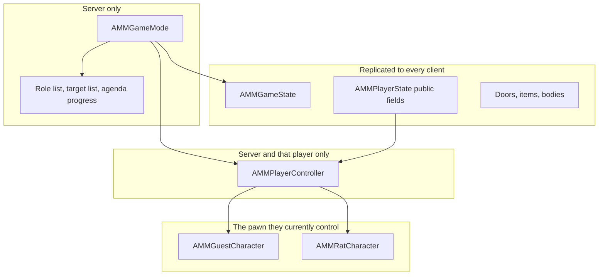

# Architecture

Status: proposal. Nothing in this file has been built. No Unreal classes will be added until this proposal is approved.

The design rules live in [GDD.md](GDD.md), version 0.4. This file says where those rules sit in Unreal Engine 5.

## Current project

The Unreal project is at [MurderAtMidnight/MurderAtMidnight.uproject](MurderAtMidnight/MurderAtMidnight.uproject). It is Unreal Engine 5.8. The module name is `MurderAtMidnight`.

It is the first-person template, plus the template's Horror and Shooter variants. It has not been changed into the murder mystery yet.

What the project already has:

- `AMurderAtMidnightGameMode`, the server game mode. It selects `AMurderAtMidnightGameState` and `AMurderAtMidnightPlayerState`. It does not assign roles or decide wins yet.
- `AMurderAtMidnightGameState`, with the public phase, phase end time, vote flag, and match result. Every client receives those fields. Nothing advances them yet.
- `AMurderAtMidnightPlayerState`, with the public life state. The player name and the possessed pawn stay on the engine classes. The role and the agenda are not stored here.
- `UMurderAtMidnightGameInstance`, set as the game instance. It holds no match secrets.
- `AMurderAtMidnightPlayerController`, which sets up Enhanced Input, touch controls, and the camera manager. Private messages are not implemented yet.
- `AMurderAtMidnightCharacter`, a first-person character with move, look, and jump.
- `AHorrorGameMode` and `AShooterGameMode`, plus shooter weapons, shooter AI, and horror UI. These are local sample modes. Their player count stops at 4, and they are not a network match.

The map that opens is `/Game/FirstPerson/Lvl_FirstPerson`. The game mode that runs is the Blueprint `BP_FirstPersonGameMode`. Online subsystem support is present in the build file as a comment, and it is not turned on.

Blueprint files under `Content` are binary. Their graphs are not readable from the text sources.

The first code step, after approval, is not a new project. It is to keep this one, leave the sample variants alone, and add the missing match classes onto the first-person base. The names below are the classes to add or extend. They stay empty of murder, roles, and agendas in that first step.

The first test map is still one library and a corridor, as in GDD section 13. `Lvl_FirstPerson` can stand in until that map exists.

## The Unreal classes

Unreal already splits a match into a few objects. We use that split as it stands. We do not add a second framework beside it.

### GameInstance — `UMMGameInstance`

Lives on each machine for the whole time the game is open. It survives map travel. It is not replicated.

It owns local things: the player's settings, and the act of hosting or joining a session.

It does not own the match. It must not store who the killer is, the target list, or any agenda. Those facts belong to the server for one match, and this object would keep them on the wrong machine.

### GameMode — `AMMGameMode`

Exists on the server only. Clients do not get a copy. That makes it the right place for secrets and for decisions.

It owns:

- Assigning the killer, the target list, and the agendas at match start.
- The evening clock and the phase changes.
- Checking a murder, a vote, an agenda, a disconnect, and a win.
- The private records: who the killer is, which targets remain, and which agendas are finished.

It does not draw UI, play the host's voice, or move characters. When a public fact changes, it writes that fact onto the GameState. When a private fact changes, it sends that fact to one PlayerController.

### GameState — `AMMGameState`

One copy exists on the server and is replicated to every client.

It owns the facts every player is allowed to know:

- The current phase.
- The server time when that phase ends, so every screen can show the same clock.
- Whether a vote is open.
- The public result, once the match has ended.
- The list of PlayerStates.

It does not own the killer's identity, the target list, agenda text, or a victim's memory of the killer. If a value is on the GameState, treat it as public.

### PlayerController — `AMMPlayerController`

One per player. The server and that player's machine have it. Other players do not get its private calls.

It owns the requests a person can make: interact, vote, and later attempt a murder. The client asks. The server decides. A request that says "I completed my agenda" or "I am not the killer" is ignored. The server already knows.

It also owns the private mailbox. The server tells this player their role, their agenda, and, if they are the killer, their target list. Those messages go to this controller only. If the player reconnects, the server sends them again.

### PlayerState — `AMMPlayerState`

One per player. Replicated to everyone. It survives the change from guest body to rat body, which is why life and identity live here instead of on the pawn.

Public fields:

- Display name.
- Life: in lobby, alive, dead, or rat.
- Which body they currently control.

That is enough for other players to see a person, a body, or a rat. The role, the agenda, and the target list do not go here. A public PlayerState is a common place to leak a secret by accident, because every client receives it.

### Character and pawn

`AMMGuestCharacter` is the living guest. `AMMRatCharacter` is the body after death.

The server handles the change. It spawns the rat, possesses it with the same PlayerController, and leaves the PlayerState in place. The guest body can remain as a visible corpse. The player does not rejoin, and they do not become a new PlayerState.

The pawn replicates movement and the actions people can see. It does not decide wins, and it does not store the killer id.

### Actor components

Components are how a pawn or a prop gains one job without a new subclass for every object.

- An interactor on the pawn asks the server to use whatever the player is looking at.
- An interactable on a door, key, paper, or cabinet receives that request.
- An inventory on the pawn stores what that person is carrying.

A cabinet does not get its own unique code path if the shared interactable can open, lock, and reveal. New behaviour is a new component, or data on an existing one, when the old actions cannot express it.

## Networking

The server decides every change that matters. Clients predict movement through Unreal's character movement. They do not predict murders, locks, agendas, votes, or phase changes.

### Authority

| Action | Who may change it |
| --- | --- |
| Phase and clock | Server, on the GameMode |
| Role, targets, agenda progress | Server, stored on the GameMode |
| Pick up, drop, give, lock, unlock | Server, after it checks the request |
| Murder | Server, after it checks range, life, and the target list |
| Vote | Server, after it checks that a vote is open and counts the ballots |
| Life and rat transformation | Server |

A client RPC is a request. The server throws it away when the player cannot do that thing.

### Replication

Public facts use normal replication on the GameState, the PlayerState, and world actors.

Private facts use a client RPC on that player's PlayerController. They are not properties on an actor that replicates to the whole match.

Examples of private RPCs:

- "You are the killer. These are your targets."
- "This is your agenda."
- "Your agenda is complete."
- "You are not sure who attacked you." This last one goes to the dead player only.

Examples that replicate to everyone:

- The phase and the clock.
- A player is alive, dead, or a rat.
- A key has moved.
- A door is open or shut.
- A vote has been called, and later the public result.

### Ownership

The player's controller owns their current pawn. World props stay owned by the server. When someone picks up a key, the server moves that key in the replicated inventory. We do not hand the key's network ownership to the client. Ownership would let that client write the key's transform and state.

### Listen server and dedicated server

The same classes support both. A listen server means one player hosts, and their machine is the server. A dedicated server means the match runs on a machine that is not also a player.

For a first test with friends, a listen server is enough and is simpler to run. It has a privacy limit, described below. The replication rules are written as if every client is untrusted, so moving to a dedicated server later does not require a new design.

## Privacy

This is the main technical risk in the game.

Each client may know its own role, its own agenda, and, for the killer, the target list. No client may learn those facts about another player from the network.

| Fact | Where it lives | Who receives it |
| --- | --- | --- |
| Killer identity | GameMode | That player's controller |
| Target list | GameMode | The killer's controller |
| Agenda text and progress | GameMode | That guest's controller |
| Victim's memory of the attack | GameMode | That dead player's controller |
| Phase, clock, vote, result | GameState | Everyone |
| Alive, dead, or rat | PlayerState | Everyone |
| Carried objects | Inventory component | Everyone |
| Text inside a document | Server, then one RPC | The player who inspected it |
| Host announcement | GameState or a multicast | Everyone |

Rules that keep it that way:

- Do not put a secret in a property that replicates to all clients.
- Do not log secrets in a way that ships to other players.
- Do not trust the client to announce its own role.
- After adding a replicated variable, name who is supposed to receive it before the change is kept.
- On reconnect, the server repeats the private RPCs to the owner. It does not repeat them to the match.

The listen-server limit: the hosting player's machine is the server, so that person can inspect the server's memory if they try. Replication stops the other seven players from receiving the secrets. It does not stop a cheating host. A dedicated server is the point where the host is just another player. Until then, a listen server is an accepted prototype risk, not a finished privacy boundary.

A second risk is a Blueprint or a UI widget that reads the GameMode. In a packaged client the GameMode is not there. In the editor, the host can see it. UI must read the GameState for public facts and the local PlayerController for private facts.

## Match state

One place on the GameMode advances the evening. The GameState mirrors the part everyone can see.

Phases:

1. Waiting for players.
2. Arrival.
3. Dinner.
4. Garden.
5. Resolution, at midnight, when three or more people are alive.
6. Hunt, when only the killer and one guest are alive.
7. Ended.

Arrival, dinner, and garden are gatherings. Players can keep walking. The phase tells the host what to announce and tells the server when a vote may be called. Missing a gathering has no mechanical penalty.

The server checks wins in this order:

1. Every agenda still in the match is complete. The guests win.
2. A vote is open and a majority of living players name the killer. The guests win. Any other ballot changes nothing and closes voting until the next gathering.
3. At midnight, with three or more living players: a living target means the guests win. If every target is already dead, the server opens the vote. The killer wins only if that vote does not name them.
4. If a death or a disconnect leaves the killer and one guest, the server starts the hunt and shortens the clock. The last guest alive at the end means the guests win. The killer catching them means the killer wins. Agendas can still finish before the catch.
5. If only the killer remains, the killer wins.
6. If the killer disconnects, the guests win.

A target who disconnects is removed from the list. That is not a kill. No new target is added. The list is one name shorter. If that leaves the killer and one guest, the hunt starts.

Death is a server step. The PlayerState becomes rat. The same controller possesses the rat pawn. The agenda stays with that PlayerState. A rat who does nothing for a couple of minutes is warned, then their agenda is dropped. Walking counts as present. A rat who is present and refuses the agenda stays in the set.

There is no Mischief meter and no reputation score. Cooldowns, if a single action needs one, sit on that action.

## C++ and Blueprint

C++ owns the rules that must behave the same in every match, and the replication that must not leak.

Blueprint and data own the parts you will want to change without a code change: durations, item names, host lines, meshes, rooms, and which agenda assets are in the deck.

| In C++ | In Blueprint or data assets |
| --- | --- |
| Phase machine and win checks | Phase lengths |
| Role and target assignment | How many targets, already set by the GDD, exposed as a number you can tune |
| Private RPCs | The words shown for an agenda |
| Interaction validation | Prompt text, highlight, animation |
| Inventory and lock checks | Which key opens which door |
| Agenda completion checks | The agenda list and its object ids |
| Life state and possession of the rat | Rat mesh, corpse mesh, host announcement |

A Blueprint may react to a phase change and play a line. It may not decide that the guests have won. The GameMode does that, then tells the GameState, then Blueprint reads the result.

Agenda definitions are data assets: a description, the completion rule id, the objects involved, and the short rat action. Adding an agenda should not require a new character class.

## Frameworks to add later

These are not extra engines. Each one is a small C++ type we will need once, then reuse.

1. Interaction. The pawn asks. The server traces. The actor responds. Pick up, drop, give, hide, inspect, and use all enter through this.
2. Inventory. A replicated list of item ids on the pawn. The server is the only writer. Carried items are visible. The contents of a letter are sent only to the reader.
3. Access. A door stores a lock id. The server looks for a matching key in an inventory.
4. Evidence. The same world actors store a visible state, such as moved or stained. They do not store the killer's player id.
5. Agendas. Data assets plus server-side progress on the GameMode. Completion is a private message to the owner.
6. Player records. The public half is the PlayerState. The private half stays on the GameMode and is copied to one controller.

Voice is separate. Unreal does not ship proximity voice. The first sessions need a known voice plugin. That choice can wait until movement and objects exist. It does not change the class split above.

## Build order

Each step is usable before the next one starts. Gameplay from the GDD waits until the step that needs it.

1. Create the C++ project and the empty classes in this document. They compile. They do not run a murder.
2. Host and join for up to eight players. Move a first-person pawn. Replicate a public phase and clock, with no win logic.
3. Interaction and inventory. Pick up, drop, and give a key. Unlock one cabinet. The server rejects bad requests.
4. Prove privacy. Send one private agenda string to its owner. Confirm with a second client that the packet or the replicated properties do not contain it.
5. Roles and a server-checked murder, then doors and clues.
6. Agendas, including the short rat action, still checked on the server.
7. The evening schedule, dinner announcements, the vote, and the hunt.
8. The rat pawn and possession.
9. Proximity voice, once the session plugin is chosen.

Steps 5 through 9 are the GDD's build order. They do not start in the architecture pass.

## Approval stops here

Steps 1 to 5 are in the project. The server assigns roles and checks a close-range kill. The next change, after it is asked for, is one agenda the server can mark complete. No vote and no rat until that step is requested.
